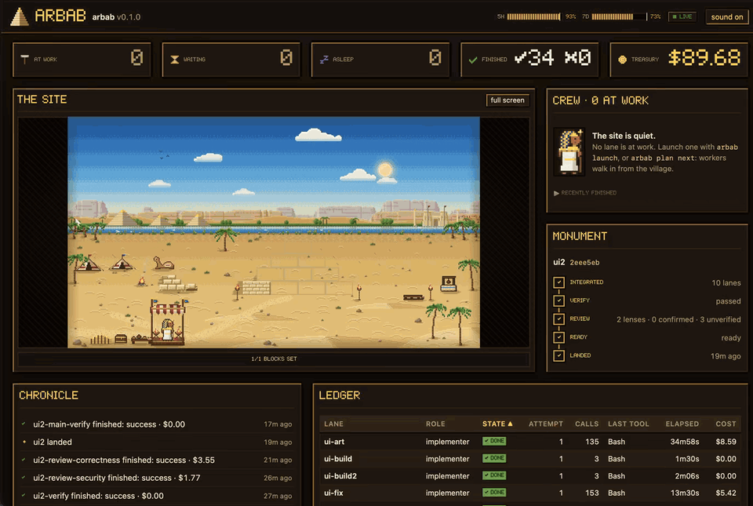

# arbab

**Turn one Claude Code session into a controlled engineering team.**

Give arbab a large engineering task. Your interactive Claude Code session splits it into independent lanes and runs
each one as a headless Claude Code worker, in parallel, in its own git worktree behind a sandbox. arbab then verifies
the result inside the fence, has it adversarially reviewed, and prepares a merge that the skill lands only on your yes.

**Parallel lanes · isolated worktrees · sandboxed workers · human-controlled merges**

[](https://github.com/ozgursagiroglu/arbab/actions/workflows/ci.yml)
[](LICENSE)




*The run that wrote this README, at 1.5× speed.*

```text
                                          ┌─> worker ─┐
you ──> your Claude Code session + arbab ─┼─> worker ─┼─> verify ─> review ─> you approve ─> merge
                                          └─> worker ─┘
```

> *arbab*: master, the one who gives the orders.
> You give the order. arbab runs the team. Claude writes the code.

arbab does not replace Claude Code: it gives your session a controlled way to delegate real engineering work. Every
worker is the unmodified `claude` binary, running under your own login.

## Why arbab

One long session plans, implements, waits on tools and tests, and fills its own context until every step slows down.
Subagents inside that session share its limits.

arbab splits the roles four ways:

- **You** decide.
- **Your Claude Code session** plans, writes narrow briefs and reacts as lanes finish.
- **Headless workers** each take one brief in their own worktree and fence, with a budget and a clock.
- **The arbab runner** does the mechanics: worktrees, sandbox profiles, quota holds, auto-resume, integration, fenced
  verification, review and landing.

### Does running in parallel help?

|                | Workflow agents in one session | Headless arbab workers |
| -------------- | ------------------------------ | ---------------------- |
| Lanes finished | 0 of 7                         | 7 of 7                 |
| Time           | stopped after 73 min           | 1.9–6.4 min each       |

This was not a controlled benchmark:

- the Workflow run was stopped at 73 minutes;
- 5 of the 7 headless lanes started from digests of the stopped work, and the two that did not were still among the
  fastest;
- approval waits took 62–70% of the Workflow's wall time.

[REQUIREMENTS.md §1](REQUIREMENTS.md#1-problem-measured) has every measurement and confound.

The point is not a speed-up number, but that independent work stops competing for one session's context and turn loop.

## How a task flows

```text
                               a task
                                 │
                                 ▼
                   your Claude Code session
                       (plan and briefs)
                                 │
            ┌────────────────────┼────────────────────┐
            ▼                    ▼                    ▼
         [ lane A ]           [ lane B ]           [ lane C ]
     worktree + sandbox   worktree + sandbox   worktree + sandbox
            │                    │                    │
            └────────────────────┼────────────────────┘
                                 ▼
                            integration
                                 │
                                 ▼
                 verification (inside the fence)
                                 │
                                 ▼
                         adversarial review
                                 │
                                 ▼
                          readiness report
                                 │
                                 ▼
                           your approval
                                 │
                                 ▼
                      merge (never pushed)
```

- **lane**: one brief, one worker, one worktree.
- **plan**: lanes in dependency waves.
- **fence**: the worker's sandbox and exact permissions.
- **integration**: the lanes' branches merged for verification and review.
- **readiness**: the report you decide on.

## Get started

You need:

- [Claude Code](https://docs.claude.com/en/docs/claude-code) 2.1.290 or newer;
- Node.js 20 or newer, and git;
- macOS (tested; the fence uses Claude Code's sandbox). Linux is untested.

Install the plugin:

```sh
claude plugin marketplace add ozgursagiroglu/arbab
claude plugin install arbab@arbab
```

The install copies only `plugin/`: the skill, its hooks and a single-file runner (the `arbab ui` page included),
with zero runtime dependencies. The plugin's hooks approve the skill's bare runner calls, all but `land`, so they do
not wait for your click, keep the session from ending its turn while its lanes run unwatched, and tell a returning
session what other sessions landed meanwhile. To update, refresh
the marketplace with `claude plugin marketplace update arbab`, then run `claude plugin update arbab@arbab`.

Then:

1. **Configure the project.** Add an `arbab.config.json` at its root:

   ```json
   {
     "baseBranch": "main",
     "instructions": ["CLAUDE.md"],
     "dependencies": { "strategy": "command", "command": ["pnpm", "install", "--frozen-lockfile"] },
     "commands": {
       "implementer": ["pnpm test", "pnpm typecheck", "pnpm build"],
       "reviewer": ["pnpm test", "pnpm typecheck"]
     },
     "gates": [["pnpm", "typecheck"], ["pnpm", "test"], ["pnpm", "build"]],
     "maxParallel": 4
   }
   ```

   - `instructions` are inlined into every brief. Workers do not load `CLAUDE.md` on their own.
   - `commands` are the only project commands each role may run.
   - `gates` are what `verify` runs; `verify.smoke` runs after them.
   - `hostGates` are checks the fence cannot run (Docker, a browser, a database). You run them with
     `arbab host-check <name>` in your terminal.
   - `fence.readableEnvFiles` lists tracked env templates (`.env.example`) that workers' shell commands may read (the
     Read tool still may not; every other `.env*` file stays denied); `fence.bashOutputMaxChars` (default 100000):
     longer Bash output is saved where workers cannot read it.
   - `landing.tier` (`low`, `medium` or `high`, default `medium`) and `landing.squash` (one commit per landing).
   - Also: `preflight.steps`, `dependencies`, `env`, `passEnv`, `credentialPaths`, `resources`, `semaphores`,
     `quota.holdAbove`, `review.lenses`, `roles`, `minClaudeVersion`, `worktreeRoot`, `runsRoot`.

   A repository that should carry no arbab file can keep the config at `.arbab/config.json` instead; arbab excludes
   `.arbab/` from git as a whole. `~/.arbab/machine.json` (`{"maxParallel": 6}`) caps parallel workers for every
   project on the machine. The skill's "Before the first launch" section explains the fields that matter first.
   [arbab.config.json](arbab.config.json) is this repository's own.
2. **Run the skill.** Open Claude Code in the project and type `/arbab`. Ask it to check the setup first; it runs
   `arbab doctor` (node, git, the claude binary, the sandbox, the config, the ignored roots).
3. **Hand it the work:** "Plan this and run it with arbab." The orchestrator splits the work into lanes, writes their
   briefs, lints and launches them, and reacts as each one finishes.
4. **Watch.** The skill starts `arbab ui`, which opens the lanes in your browser as workers building a pyramid.
   `arbab status` shows the same as a table.
5. **Land.** The orchestrator integrates, verifies, reviews and writes `readiness.md`, then asks you. You say yes; it
   lands. When the landing affects another session's lanes or runner, readiness names that session and the
   orchestrator tells it before landing; `land` warns about it again as it merges, a last record.

Some steps are always yours:

- **Dependency changes.** If a worker changed what an install reads (a lockfile, a package manager's config, a
  dependency patch, a vendored yarn release or plugin, or the dependencies or install scripts of a `package.json`),
  nothing is installed. You review the change, install it yourself, and confirm with
  `arbab integrate <name> --deps-installed <sha>` in your own terminal. The CLI refuses that confirmation without a
  terminal, so an agent cannot give it for you.
- **Waivers and host checks.** `arbab readiness <name> --waive <id>` and `arbab host-check <name>` need a terminal
  too.
- **Landing.** `land` is the orchestrator's command, but the skill asks you first, and the plugin's hook never
  approves it. It never pushes.

## A real run

This is how arbab built part of itself: the `ui2` milestone, the game-studio pass of `arbab ui`, from the first check
to the landing. The outputs are real, trimmed, and their paths shortened. The commands are what the orchestrator ran,
shown as `arbab <command>`; the skill's own form of each is `node "${CLAUDE_PLUGIN_ROOT}/dist/arbab.mjs" <command>`.

**1. Ask for it.** In Claude Code, type `/arbab`, then "Plan this and run it with arbab." The session writes a plan and
one brief per lane.

**2. Check the plan.** `arbab plan check plans/ui2.json` lints every phase and prints the waves.

```text
ui2-font: ok
ui2-scene: ok
ui2-art: ok
ui2-hud: ok
ui2-wire: ok
wave 0: ui2-font, ui2-scene
wave 1: ui2-art, ui2-hud
wave 2: ui2-wire
plan ui2: ok
```

**3. Launch the first wave.** `arbab plan next plans/ui2.json` launches every phase whose dependencies have all
succeeded. The orchestrator runs it again after each finish, so the next wave starts as soon as it can.

```text
launched ui2-font  run ~/arbab/.arbab/runs/ui2-font  shepherd 20399
launched ui2-scene  run ~/arbab/.arbab/runs/ui2-scene  shepherd 20436
blocked ui2-art  waiting for ui2-font
blocked ui2-hud  waiting for ui2-font
blocked ui2-wire  waiting for ui2-font, ui2-scene, ui2-art, ui2-hud
```

**4. Wait for a finish.** The orchestrator runs `arbab wait --any` in the background. It prints a line when a lane
finishes.

```text
ui2-art#1 success 45m37s turns=115 calls=248 failed=12 cost=$15.46 report=~/arbab/.arbab/runs/ui2-art/attempt-1/report.json
```

**5. Look at every lane.** `arbab status`, given the milestone's lanes, prints one row per lane, then the quota. This
capture predates the `why` column that `status` now prints last (see
[Know what your workers are doing](#know-what-your-workers-are-doing)).

```text
lane                 state               attempt  elapsed  turns  calls  last tool  effort  failed  cost    quota
ui2-font             finished (success)  1        7m40s    18     28     Bash       high    1       $1.27   5h 34% · 7d 62%
ui2-scene            finished (success)  1        11m02s   31     51     Bash       high    2       $2.58   5h 35% · 7d 62%
ui2-art              finished (success)  1        45m37s   115    248    Bash       high    12      $15.46  5h 65% · 7d 67%
ui2-hud              finished (success)  1        24m02s   64     107    Bash       high    3       $7.38   5h 50% · 7d 65%
ui2-wire             finished (success)  1        24m59s   124    262    Bash       high    11      $10.30  5h 82% · 7d 70%
…
ui2-verify           finished (success)  2        1m34s    4      3      Bash       low     0       $0.00   5h 92% · 7d 72%
quota: 5h 93% (resets 11:20Z) · 7d 73% (resets Oct 21 10:00Z)
```

**6. Integrate.** `arbab integrate ui2 --plan plans/ui2.json` merges the lane branches into `integrate/ui2`, wave by
wave.

```text
merged ui2-font 5b75f913e3e6ee406f3b63080b596d360d3906a3
merged ui2-scene 849e12a888014de8d7aed8a33518589dc5cf38d7
merged ui2-art a75312440e7a7a5269ac1f427a3a5b60189a7570
merged ui2-hud c1394dfed9827a88b802365187699ab5c1e2ab98
merged ui2-wire 973e88ef59097e2f018c2336611443e4312d85c2
head 2016972fe34166fb7addfb9aa44078218ca9f310  (integrate/ui2 in ~/arbab/.arbab/worktrees/integrate-ui2)
```

**7. Verify.** Five more lanes were integrated after these five (polish, build, pay, fix and a second build), so
verify ran on the final head. `arbab verify ui2` runs the gates inside the fence, in a lane that has no file-editing
tools.

```text
launched ui2-verify; waiting
exit 0    gate   pnpm typecheck
exit 0    gate   pnpm test
exit 0    gate   pnpm build
verify ui2: passed at 2eee5ebfb9021b5214ad39f0be0e18bc9bb6e96d (lane ui2-verify success)
```

**8. Review.** This is `arbab review ui` on the first `arbab ui` integration. One reviewer lane runs per lens, then
skeptics check the findings.

```text
launched ui-review-correctness, ui-review-security, ui-review-contracts; waiting
launched ui-skeptic-correctness, ui-skeptic-security, ui-skeptic-contracts; waiting
correctness  review   ui-review-correctness  success  22 paths
security  review   ui-review-security  success  32 paths
contracts  review   ui-review-contracts  success  20 paths
correctness  skeptic  ui-skeptic-correctness  success
security  skeptic  ui-skeptic-security  success
contracts  skeptic  ui-skeptic-contracts  success
confirmed (6)
  correctness-1  MEDIUM  test/assemble-plugin.test.ts:125  Committed plugin/ was not rebuilt: the marketplace bundle has no `arbab ui` …
  correctness-2  LOW  src/ui/server/snapshot.ts:139  reportStatus and findings come from an older attempt when the latest attempt …
  security-1  LOW  skills/arbab/SKILL.md:178  The skill's background `arbab ui` call writes the session token to disk, …
  contracts-1  MEDIUM  plugin/skills/arbab/SKILL.md:178  Committed plugin/ was not rebuilt: the marketplace install …
  contracts-2  LOW  src/ui/client/scene/scene.ts:57  Preflight probes keep the probed lane's role, so the scene draws them …
  contracts-3  LOW  src/ui/server/snapshot.ts:139  reportStatus and findings come from an older attempt when the newest …
…
```

Every confirmed finding was fixed by a fix lane before landing.

**9. Readiness.** `arbab readiness ui2` writes `readiness.md`. Its head:

```text
# Readiness report — ui2

Tier: medium · Head: `2eee5ebfb9021b5214ad39f0be0e18bc9bb6e96d` · Date: 2026-10-19

## Verified

| Check | Result |
| --- | --- |
| `verify:pnpm typecheck` | gate: exit 0 |
| `verify:pnpm test` | gate: exit 0 |
| `verify:pnpm build` | gate: exit 0 |
| `review:correctness` | lens ran, 27 paths checked |
| `review:security` | lens ran, 27 paths checked |
| `findings` | 0 confirmed, 0 refuted, 3 unverified |
```

**10. Land.** The human said yes, and the orchestrator ran `arbab land ui2`. It merges into `main` and removes the
worktrees. It never pushes.

```text
landed ui2: 2eee5ebfb9021b5214ad39f0be0e18bc9bb6e96d into main as be2be12beb53e8f59cfca733ac579a6e1e42124a
Not pushed. To publish: git push origin main
removed worktree ~/arbab/.arbab/worktrees/ui2-font
…
```

What the fence refuses is in [Safe by construction](#safe-by-construction); how to watch the lanes as they run is in
[Know what your workers are doing](#know-what-your-workers-are-doing).

## Safe by construction

**Workers can write code. They cannot touch your working tree, your git history or your remote.**

Every worker gets:

- **Its own git worktree and branch.** A lane can instead borrow another lane's worktree, as a verifier does after its
  builder. Your checkout is never its working directory.
- **Claude Code's sandbox.** Writes stay in its worktree and the few shared places Claude Code's sandbox allows, such
  as the per-user temp directory and `~/.npm/_logs`; keep nothing you trust there while lanes run. There is no
  network unless the lane is a researcher. A sandbox that cannot start is fatal, never a silent fallback.
- **`dontAsk` permissions with its role's exact tools.** A tool left out of the role does not exist for the worker.
- **An allowlist of project commands.** The lint refuses "any code" prefixes such as bare `node` or `pnpm`. An allowed
  command can still run code the worker wrote (`pnpm test` runs its tests), so the sandbox is what contains that code.
  A lane can opt into the `sandbox-auto` fence, which drops the allowlist and leaves the sandbox as the only wall.
- **No background shells.**
- **No writes to the repository's shared `.git`.** Git writes are denied, and the runner commits.
- **A scrubbed environment, with credential paths denied.** The environment is built from scratch, and paths such as
  `~/.ssh`, `~/.aws` and `**/.env*` cannot be read or edited. A lane's `inputs`, files from outside the
  repository, are copied into its worktree afresh on every run, never through a link the worker left there. The same
  credential list plus your `credentialPaths`, matched in any case, keeps arbab itself from copying a credential file
  in as an input, inlining one into a prompt (a brief, a schema, `instructions`, a review lens) or committing one as a
  landing message. Every kind of `credentialPaths` entry guards inputs, lens files and `--message`; the brief, schema
  and `instructions` files are guarded by the relative, `//` and `**/` entries only, since `~/` entries match nothing
  there. For files inside the project, inputs included, name rules such as `.env*` and relative entries such as
  `vault/*.md` look only below the project root, so a project kept under a folder like `~/.envs/` still works.
- **A budget and a clock.** Every attempt has a dollar cap, a wall-clock limit and an idle limit.

On your machine:

- **Tests run in the fence.** `verify` runs the gates in a sandboxed lane without file-editing tools, and the tree must
  be clean after the run.
- **Installs happen only on trusted commits.** The dependency command runs on the host, so it only runs on a commit
  your base branch contains or an integration head you confirmed. Worker code is merged after the install.
  `integrate --adopt` installs at the fork point of the adopted branch and its base, so it refuses a `--base` your
  base branch does not contain.
- **Host git never runs worker code.** No hooks, no `core.fsmonitor`, no submodule recursion. Checkpoints never commit
  nested repositories.
- **Refusals are counted, never retried in secret.** A call the fence refuses shows up in `status`, not as a hidden
  retry.
- **`land` lands only the verified tree, and never pushes.** It prints the push command and leaves it to you.

The workers can work aggressively. Your repository stays under your control. The full threat model and the review
history are in [DESIGN.md](DESIGN.md). Found a hole? See [SECURITY.md](SECURITY.md).

## Reviews that try to prove you wrong

**Don't ask one agent whether its own work is correct.**

- **One reviewer lane per lens:** `correctness`, `security`, `contracts`, or your own from `review.lenses` in the
  config.
- **A depth floor.** Every changed file is read in full, and every finding names a file, a line, a failure scenario
  and evidence.
- **A skeptic lane per lens** tries to refute each MEDIUM or HIGH finding.
- **Verdicts:** each finding ends `confirmed`, `refuted` or `unverified`.
- **A readiness report** lists what was verified, what was skipped, and every risk.
- **Other sessions hear about a landing.** When another session runs lanes or waiters in the project, or
  runs a runner file the landing replaces, readiness lists it as a `session:<id>` risk, and the skill tells that
  session before it runs `land`. `land` prints a warning for it too, but in the same call as the merge: a last
  record, which also names sessions that appeared since readiness. Neither blocks. Run outside Claude Code (no
  session id, such as `readiness --waive` in a terminal), readiness and `land` count every session as another, the
  orchestrator's own included.
- **A returning session catches up.** Each landing records the session that made it. When a session comes back
  after a pause, a usage limit or `claude --resume`, the plugin's hooks tell it, with its next message, what other
  sessions landed while it was away, in its project or, started in a parent folder, in each registered project inside
  it; a new session gets no history. `arbab summary --since <when>` (`2h`, `1d`, a date `YYYY-MM-DD` as midnight UTC,
  or an ISO date-time with `Z` or an offset) lists the landings on demand. When the base moved under an integration, readiness
  says so as its first risk, `base-moved`, naming the landings it lacks, before `land` refuses it.
- **A skipped check blocks the landing.** `land` refuses while one is left, unless it is waived by its id; `verify`
  cannot be waived. Only you can waive one: `--waive` needs a terminal.

On arbab's own `arbab ui`, the first review round confirmed six findings. The two MEDIUM ones were the same problem,
found by two lenses independently. All six were fixed before landing. Milestone M3 went through 14 review rounds,
and its review lanes found two paths by which worker code could have run on the host.

## Know what your workers are doing

`arbab status` prints one row per lane: its state, attempt, time, work, effort, failures, cost and the quota it saw.
This is part of the `ui2` build of arbab's own page, captured before `status` gained its last column, `why` (below),
so the rows end at the quota:

```text
lane                 state               attempt  elapsed  turns  calls  last tool  effort  failed  cost    quota
ui2-font             finished (success)  1        7m40s    18     28     Bash       high    1       $1.27   5h 34% · 7d 62%
ui2-art              finished (success)  1        45m37s   115    248    Bash       high    12      $15.46  5h 65% · 7d 67%
ui2-wire             finished (success)  1        24m59s   124    262    Bash       high    11      $10.30  5h 82% · 7d 70%
ui2-fix              finished (success)  1        8m21s    45     88     Bash       high    3       $2.94   5h 91% · 7d 72%
ui2-review-security  finished (success)  2        2m33s    23     39     Grep       high    1       $1.77   5h 92% · 7d 73%
ui2-verify           finished (success)  2        1m34s    4      3      Bash       low     0       $0.00   5h 92% · 7d 72%
quota: 5h 93% (resets 11:20Z) · 7d 73% (resets Oct 21 10:00Z)
```

- **turns**: the model's turns, counted as distinct assistant messages.
- **calls** and **last tool**: the tool calls the worker made, and the one it made last.
- **effort**: how hard the model thought, measured from the session transcript, not just the level requested.
- **failed**: tool calls that failed, refusals by the fence included. Each attempt's `summary.json` splits them by
  cause: the permission mode, a deny rule, the scope, the sandbox, a real error, and others.
- **cost**: the session's cost so far, and the share of it that each attempt added. When there is no cost (a killed
  attempt, say), the tokens it used instead: input, cache creation and output, as `41.2k tok`.
- **quota**: the five-hour (5h) and seven-day (7d) windows as the lane last saw them. The last line is the account's
  newest snapshot, with each window's reset time.
- **why**: the reason for the lane's state, such as `no free slot` for a held lane or `usage limit` for one waiting
  for the reset, cut to 40 characters. A finished lane keeps a reason only when its shepherd itself hit an error,
  for example while loading the lane, preparing the worktree or copying inputs: `why` holds the error's message, and
  the row reads `finished (failed)`. A lane that finished with the end state of its last attempt (`success`, a failed
  attempt, a budget or time limit) or by `arbab stop` has an empty `why`.

### Costs and the quota

- Costs are Claude Code's API-equivalent estimates; on a subscription they are notional. Each attempt has a budget,
  passed to Claude Code as `--max-budget-usd`. It is a client-side cost estimate and does not cap subscription quota.
- Launches wait in the `held` state while the five-hour window is at or above its threshold (85% by default) or the
  seven-day window is at or above its own (95% by default). A held lane checks again every minute and after each
  reset. Parallel workers spend quota in proportion: N workers use it about N times as fast as one.
- A worker that hits a usage limit waits for the reset and resumes its own session; it does not start over.

### Watch it build

`arbab ui` serves a live, read-only page of your lanes on 127.0.0.1: a pixel-art scene inside a dashboard.

- **The scene**: each lane is a worker building a pyramid, and arbab is the foreman at the front. A worker walks up to
  talk when it takes its brief, and again when it delivers its report.
- **The stones**: each tool call sets a stone. When a lane finishes, its block is set, or its stones fall.
- **Landings**: a landing hoists the capstone in a beam of light. Landed integrations stand on the horizon.
- **The quota and the spend**: held lanes wait in the camp, and the sky turns to dusk while launches are held and to
  night while the account is rejected. Sleeping workers wait for the reset. The coin pile grows with the spend.
- **Around the scene**: quota gauges, KPI cards, the crew, the integration's progress, a chronicle of what happened,
  and a ledger of every lane.

Sound is off until you turn it on. Then a horn sounds for each brief and report, a drum for each stone, and coins
clink as a finished worker takes its pay.

## Commands

| Command | What it does |
| --- | --- |
| `doctor` | Checks node, git, the claude binary, the sandbox, the config, the ignored roots, `~/.arbab`, the plugin hook, the gates against the repository's scripts and CI, env templates, lint and test configs that would scan `.arbab/`, disk and the machine cap. |
| `lint <lane.json>` | Lints the profile, brief and schema. Exit 1 on errors. |
| `launch <lane.json>` | Lints the lane, then starts its shepherd. |
| `plan check <plan.json>` | Validates a plan, lints every phase and prints the waves. Exit 1 on errors. |
| `plan next <plan.json> [--retry <phase>]` | Launches every phase whose dependencies all succeeded and that never ran. `--retry` first relaunches a phase that failed or was orphaned. |
| `plan status <plan.json>` | One row per phase: wave, state, end state, dependencies. |
| `status [lane…] [--active] [--mine]` | One row per lane, then the quota. `--active`: lanes not finished; `--mine`: this session's runs and ownerless ones. |
| `summary [--all] [--since <when>]` | One screen: lanes by state, plans, integrations by stage, what needs attention, quota and slots. `--all`: every project that launched a lane on this machine. `--since`: what landed after `<when>` (`<n>m`, `<n>h`, `<n>d` ago, a date `YYYY-MM-DD` as midnight UTC, or an ISO date-time with `Z` or an offset) and which session landed it. |
| `report <lane> [--attempt <n>]` | An attempt's metrics and the worker's report, the latest unless `--attempt`. |
| `wait [lane… \| --any \| --all] [--all-sessions] [--timeout-min N] [--notify]` | Reports finished lanes not yet acknowledged. Without lanes it covers this session's runs and ownerless ones, every session's with `--all-sessions`. `--notify` sends a desktop notification. Exit 3 on timeout. |
| `resume <lane> [--prompt <file> \| --digest]` | Starts a new attempt in the latest session. `--digest` starts a fresh session seeded with the latest attempt's digest. |
| `stop <lane>` | Stops the lane's shepherd and worker. |
| `preflight <lane.json> [--timeout-min N]` | Probes the lane's fence and model. Exit 1 on any failed check. |
| `quota [--reset \| --refresh]` | Shows the account snapshot and the hold decision. After you switch accounts, `--refresh` reads the new account's windows with one haiku call; `--reset` only deletes the snapshot. |
| `cleanup [--worktrees [--older-than <days>]] [--mine]` | Reaps orphans, releases stale pool entries and removes empty lock directories and session watermarks unused for 30 days. `--worktrees` also removes finished lanes' clean worktrees merged into the base or landed (lane branches stay) and landed integrations' worktrees and branches; `--older-than` adds clean worktrees unchanged for longer. `--mine`: only this session's runs. |
| `integrate <name> --lanes a,b \| --plan <plan.json>` | Merges lane branches into `integrate/<name>`, in order or by plan waves. |
| `integrate <name> --adopt <ref> [--base <branch>]` | Makes an integration of an existing branch, so work done outside lanes gets verify and review. The base (`--base`, or config `baseBranch`) must be a branch, since `land` merges into it, and contained in your base branch: the install runs at the fork point. |
| `integrate <name> --refresh` | Records the integration's head again after a hand commit or a merge of the base in its worktree. Merges and installs nothing. |
| `integrate <name> --deps-installed <sha>` | Records that you reviewed and installed changed dependencies at that head. Terminal only. |
| `verify <name> [--timeout-min N]` | Runs the gates and smoke inside the fence on the integration head. Exit 1 unless all pass, 3 on timeout. |
| `verify --ref <branch>` | The same on a branch head with no integration: the check after landing. |
| `review <name> [--lenses a,b] [--lens-file <lens>=<file>]… [--since <sha>] [--timeout-min N]` | One reviewer lane per lens, then skeptics for MEDIUM+ findings. `--lens-file` adds or replaces a lens for one run, from a file inside the project that is no credential file by the fence's list and `credentialPaths` (`.env*`, `*.pem`, `*.key`…, in any case); `--since` diffs from an ancestor of the head instead of the base, for a fix round. |
| `readiness <name> [--tier low\|medium\|high] [--waive id,…]` | Writes the readiness report: verified, skipped, risks. Exit 1 unless ready. `--waive` needs a terminal. |
| `host-check <name>` | Runs config `hostGates` on the integration head, on the host. Terminal only. |
| `land <name> [--squash] [--message <file>] [--keep-worktrees]` | Merges a ready integration into the base, or as one commit with `--squash` (config `landing.squash`). The `--message` file must be inside the project and no credential file, checked as for `--lens-file`. Never pushes. Then removes its worktrees unless `--keep-worktrees`. |
| `ui [--port N] [--hours N] [--no-open]` | Serves the live pyramid scene on 127.0.0.1, read-only, until stopped. |
| `help [<command>]`, `--help` | Prints the command list, or one command's options (as does `arbab <command> --help`). |
| `version`, `--version` | Prints the arbab version. |

Every command except `help`, `version` and `host-check` also takes `--json`, which prints JSON instead of text. A
leading `-C <dir>` finds the project from `<dir>` instead of the working directory. arbab refuses a lane worktree as
a project, from `-C` or the working directory, whether it lies under `.arbab/worktrees` or the configured
`worktreeRoot` (also when that is a link elsewhere in the project and the lane is reached by its real path), in any
spelling of case.

The skill runs these as `node "${CLAUDE_PLUGIN_ROOT}/dist/arbab.mjs" <command>`, bare. The plugin's PreToolUse hook
approves that form, with these limits:

- It never approves `land`, which the skill asks you about first anyway, nor `help` and `version`.
- It approves `-C <dir>` only when `<dir>` is the absolute path of a project that has launched a lane on this
  machine, outside lane worktrees and temporary directories.
- A call wrapped in `cd`, `&&` or a pipe waits for your approval.

From a clone, run `node dist/arbab.mjs <command>` after `pnpm build`.

## What arbab is not

- **Not another coding agent.** The workers are the unmodified Claude Code binary (`claude -p`), under your own
  login. arbab decides how they run, fences them and checks their work.
- **Not a replacement for Claude Code.** It is a plugin for the session you already use: a skill plus a runner.
- **Not an autonomous deploy bot.** Workers cannot push or deploy. The skill lands only on your yes, and `land` never
  pushes.
- **Not a generic agent framework.** It is opinionated about software work: worktrees, sandboxes, verification,
  review and controlled integration. For a short fan-out inside your session, Claude Code's Workflows are the simpler
  tool; the [FAQ](#faq) compares them.

## Built with itself

arbab was built by its own method, as an interactive orchestrator with headless workers. Milestones M1–M3 took 146
worker attempts and 5,091 tool calls. Only 1.3% of those calls were refused by the fence; hand-made fences on other
machines measured 5.8–15%. The notional API-equivalent cost was about $225, run on a subscription.

M3 alone went through 14 review rounds, 10 of them with all three lenses. Among what the review lanes found and the
fix lanes closed were two paths by which worker code could have run on the host. Every run is in
[bench/RUNS.md](bench/RUNS.md), with notes in [bench/README.md](bench/README.md).

`arbab ui` was built the same way, in two plans: 46 worker attempts and 2,177 tool calls, at about $105
API-equivalent on a subscription. The second plan was the game-studio pass. In it, an orchestrator checked every page
in a real browser and sent the fixes back as lanes.

## FAQ

**What is arbab?**
A Claude Code plugin: a skill that teaches your session the orchestration method, plus a runner CLI that launches,
fences, supervises and measures headless `claude -p` workers.

**How is it different from Claude Code subagents or the Task tool?**
Subagents run inside your session and share its context, limits and lifetime. arbab workers are separate
`claude -p` processes, each in its own git worktree with its own fence, budget and clock. They survive usage limits:
a worker waits for the reset and resumes the same session. Their work is reviewed and landed through gates instead of
being merged as it comes.

**How is it different from Workflows, agent teams, agent view and Projects?**
Claude Code's docs list five ways to work on several tasks at once: subagents, agent view, agent teams, dynamic
workflows and Projects. As of Claude Code 2.1.295 and its docs in October 2026:

- [Workflows](https://code.claude.com/docs/en/workflows) run many subagents from a script and cross-check their
  results, inside your session and under one sandbox. They document no per-agent effort or $ cap, and `parallel()`
  waits for every agent before the script continues.
- [Agent teams](https://code.claude.com/docs/en/agent-teams) are experimental, and teammates inherit the lead's
  effort level.
- [Agent view](https://code.claude.com/docs/en/agent-view) runs background sessions (`--bg`), which cannot be
  combined with `-p`. They get no budget cap and no report schema, and Claude Code's usage-limit wait does not apply
  to them.
- [Projects](https://code.claude.com/docs/en/claude-projects) are one ongoing conversation that starts a thread for
  each task, mostly in the cloud. They are in public beta on Pro and Max plans.

For a short fan-out inside your session, Workflows are the simpler tool. arbab is for long, risky or unattended work:
local headless `claude -p` workers that survive usage limits, gates and review on the result, and a landing that the
skill makes only on your yes.

**How is it different from claude-squad, ccmanager, container-use and other worktree managers?**
They give each agent its own worktree or container and a UI, and you drive and review each agent yourself. With arbab
your interactive session drives the workers: it writes the briefs, launches the lanes, reacts as each one finishes,
and takes the results through verify, review and readiness before you decide.

**How is it different from orchestrators that review before merging?**
Some, such as [claude-orchestrator](https://github.com/indiekitai/claude-orchestrator), have another model review
each batch of worktree agents before merging. In arbab, every worker also runs behind Claude Code's sandbox, and the
skill lands nothing until you say yes.

**Does it work with a Claude subscription or the API?**
Both. It runs the unmodified `claude` binary under your own login, on your machine. It never reads, stores or
proxies your credentials, and there is no hosted mode. What your plan allows is set by Anthropic; check the
[legal and compliance page](https://code.claude.com/docs/en/legal-and-compliance) before you run large fleets.
Costs in the reports are Claude Code's API-equivalent estimates.

**Is it safe to let workers run unattended?**
Workers are fenced by Claude Code's sandbox and an exact permission profile. arbab never runs their code on the host
outside that fence, except a dependency install you confirmed, and the skill lands nothing without your approval.
See [Safe by construction](#safe-by-construction).

**Does arbab push to my remote?**
Never. `land` merges locally and prints the push command.

**What happens when I hit a usage limit?**
New launches are held while the quota is above your threshold. A running worker that hits the limit waits for the
reset, plus a little jitter, and resumes the same session. After switching accounts, run `arbab quota --refresh`: one
small call reads the new account's windows.

Parallel workers use quota in proportion: N workers use it about N times as fast as one. Each attempt's budget is
passed as `--max-budget-usd`, which is Claude Code's client-side cost estimate; it does not cap subscription quota.

**Which platforms are supported?**
macOS is tested. Linux should work wherever Claude Code's sandbox works, but it is untested so far.

## Documentation

| Document | What it holds |
| --- | --- |
| [skills/arbab/SKILL.md](skills/arbab/SKILL.md) | The method the orchestrator follows: briefs, lanes, plans, quota, review, landing |
| [DESIGN.md](DESIGN.md) | The source of truth for behaviour: process model, fence, brief contract, CLI, landing, security rules |
| [REQUIREMENTS.md](REQUIREMENTS.md) | Why: the measured problem, requirements, decisions, milestones |
| [research/](research/) | What Claude Code does natively, run metrics, retrospectives, prior art |
| [bench/](bench/) | The run ledger of arbab's own build |

## Contributing

Issues and pull requests are welcome.

```sh
pnpm install
pnpm typecheck
pnpm test
pnpm build      # bundles dist/arbab.mjs and assembles plugin/; commit plugin/ with your change
```

The project rules (zero runtime dependencies, tests for every export, no shell strings) are in
[CLAUDE.md](CLAUDE.md).

## License

[MIT](LICENSE) © Özgür Sağıroğlu
